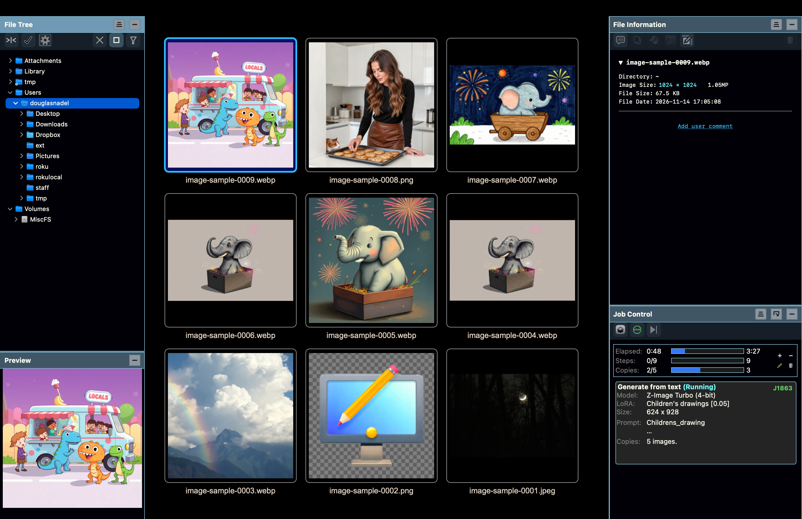

# Prowser

A fast, feature-rich image browser for macOS.

**Prowser** (**P**ersonal Image B**rowser**) is a native, open source image browser for **Apple Silicon** Macs running **macOS Sonoma (14) or later**. It reads directly from your existing folders—no import step—and gives you keyboard-driven navigation, powerful search, and practical organization tools in one app.

Completely **optional** AI features—including captioning, search, and generation—are available when you turn them on in Settings.

## What you can do

- **Browse** large folders smoothly, with thumbnails and quick preview
- **Organize** files with drag-and-drop, batch operations, and favorites
- **View** EXIF and metadata, run slideshows, and send an image to an external editor
- **Search** in powerful ways—find similar images, spot duplicates, search by description, or match faces (these features download helper models the first time you use them; later runs are much faster)
- **Customize** appearance with light, dark, and saved themes
- **Optional extras**—local image generation tools, a chat pane, and integrations with local AI tools if you set them up in Settings

Press **F1** or **/** inside the app for built-in help. For a full shortcut list, see [KEYBOARD.md](swift/KEYBOARD.md).

## Download

Get the latest installer from **[waltzremote.com](https://waltzremote.com/)**.

1. Open the download (DMG).
2. Drag **Prowser** into **Applications**.
3. Open it from Applications. If macOS asks for access to your photos or folders, allow it so the app can show your images (you may need to quit and open the app again after granting access).

Optional AI features may download models from [Hugging Face](https://huggingface.co/) (a free account may be required for some downloads). Captioning and automatic prompt generation need [LM Studio](https://lmstudio.ai/download). **16GB RAM or more** on Apple silicon is recommended for the heaviest AI features.

## First-time notes

Some advanced features need a one-time download of AI models or, for generation, extra setup in **Settings**. That can take a while on a slow connection.

## For developers

Prowser is built with Swift (AppKit and SwiftUI). Clone this repository and follow [swift/README.md](swift/README.md) to build and run from source.

## License

Prowser is offered under the [Business Source License 1.1](swift/LICENSE). Third-party components are credited in the app under **About**.